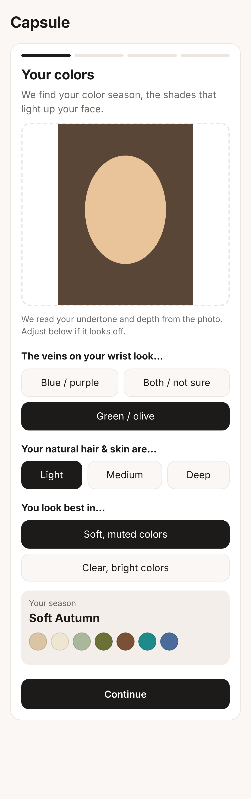
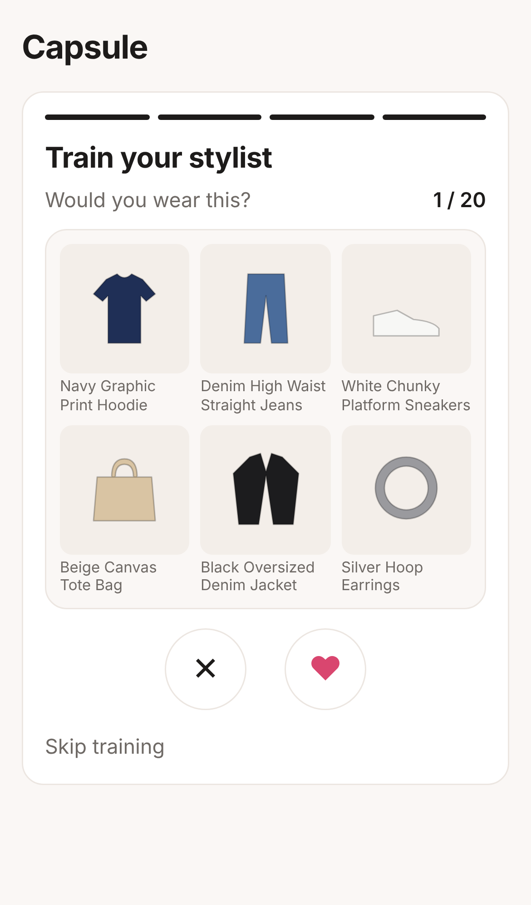
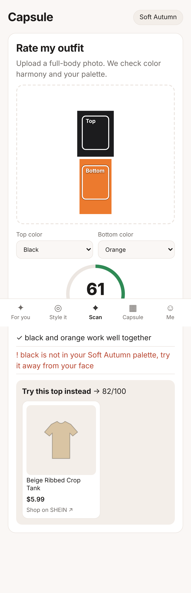
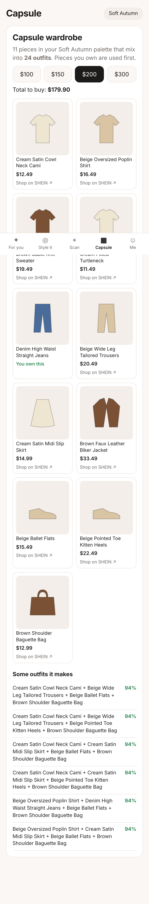

# Capsule — a Dressly-style AI stylist (POC)

Capsule copies the logic of the Dressly app: it builds your style profile
(color season, body shape, taste), then shows complete outfits from SHEIN ranked for you.
See [docs/DRESSLY_ANALYSIS.md](docs/DRESSLY_ANALYSIS.md) for how Dressly works and what we copied.

## Try it

**Live app:** https://tamar-rotenberg.github.io/-CapsuelApp/ (deployed automatically from `main`).
On a phone, use "Add to Home Screen" to install it like an app; it also works offline.

## Run locally

```bash
npm start        # http://localhost:3000  (no dependencies to install)
npm test         # engine tests
```

## The flow

1. **Your colors**: 3 quick questions (or a selfie) → one of 12 color seasons + palette.
2. **Your shape**: pick a body shape, or enter bust / waist / hips.
3. **Your style**: styles you like + budget per outfit.
4. **Train your stylist**: 20 outfit cards, like or dislike (tap or swipe).
5. Then the app has 5 tabs:
   - **For you**: personal outfit feed, each look with a "% for you" score and why it was picked.
   - **Style it**: pick a SHEIN item or upload your own piece → outfits around it.
   - **Scan**: photo of your outfit → score /100, what works / what doesn't, one SHEIN swap.
   - **Capsule**: ~11 pieces in your palette and budget that mix into many outfits.
   - **Me**: your palette, colors to avoid, shape tips, and your closet ("I own this").

| Colors | Swipe | Feed | Scan | Capsule |
|---|---|---|---|---|
|  |  |  |  |  |

## Code map

| File | What it does |
|---|---|
| `public/catalog.js` | Mock SHEIN-style catalog (~150 products) with style and cut tags. Links open a SHEIN search. |
| `public/matcher.js` | Outfit building: color harmony + style fit, fills outfit slots around one piece. |
| `public/profile.js` | 12 color seasons, body-shape rules, taste learned from swipes, personal outfit score + reasons. |
| `public/stylist.js` | Swipe deck, personal feed, outfit scanner, capsule builder. |
| `public/vision.js` | In-browser color reading from photos (skin tone, top / bottom colors). |
| `public/views/*` | One file per screen. Profile is saved in the browser. |

## Real SHEIN products

The live app uses **30 real SHEIN US products** (photos, prices, product links) fetched with the
Apify [SHEIN Scraper](https://apify.com/hypebridge/shein-scraper). Scraping costs money (about $0.12 per
product + $0.10 per search) and goes against SHEIN's terms, so it is kept small and run by hand:

1. Edit the searches in `scripts/apify-queries.json` (query, color, how many).
2. `APIFY_TOKEN=... NODE_USE_ENV_PROXY=1 node scripts/fetch-apify.mjs --budget 4` (stops before going over budget or your Apify credit; already-fetched searches are skipped).
3. `node scripts/build-catalog.mjs` (free) rebuilds `public/data/products.json`; commit it.

### Or: an affiliate product feed


1. Join the SHEIN affiliate program (directly, or through a network such as CJ, Awin or Impact) and get your **product feed link** (CSV, TSV or JSON, gzipped is fine).
2. In GitHub: **Settings → Secrets and variables → Actions → New repository secret**, name `SHEIN_FEED_URL`, value = the feed link.
3. Run the **Test and deploy** workflow (or wait for the daily refresh). It imports the feed and publishes real products with photos, prices and your affiliate links.

To try a feed locally: `node scripts/import-feed.mjs path/or/url/to/feed.csv` then `npm start`.
The importer sorts products into categories, palette colors, styles and cuts from their titles, skips what doesn't fit
(men's, kids, sets, prints, home goods), and keeps up to 150 products per category with a spread of colors.

## Not in this POC

- Virtual try-on (needs a generative try-on model).
- Real face / body detection (a model would replace the simple photo color reading).
